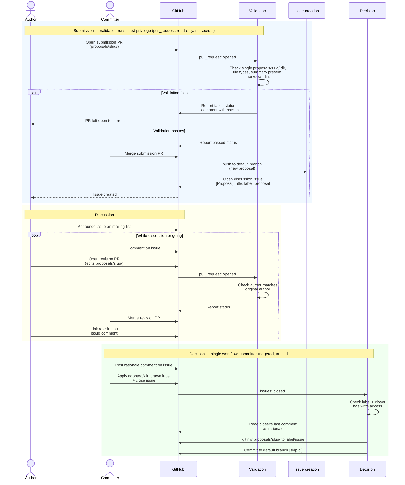

# 145 - Updated proposal workflow

This changes how design proposals are created, discussed and decided.

Today a proposal is a pull request, which is both the place the proposal is discussed and the mechanism that records whether it was accepted. This proposal separates those two jobs and gives a proposal a life of its own in the repository.

A proposal is merged into the repository on submission rather than at the end, so its content lives in the project's history from the start, regardless of what happens to the author's fork. Whilst it is under discussion it sits in a `proposals/` folder, so the set of proposals under active consideration is the contents of that folder. Discussion happens on a dedicated GitHub issue linked to the proposal rather than on the submission pull request, which gives a single stable thread for the life of the proposal.

A decision moves the proposal out of `proposals/` into one of two folders: `adopted/` for proposals that will be implemented, and `withdrawn/` for those that will not. The committer's rationale is written into the proposal document as part of the move. Every proposal therefore becomes a durable, discoverable record of what was decided and why, whether adopted or withdrawn, in place of a closed pull request whose outcome lives only in its comments.

## Current situation

A proposal today is a pull request. A contributor opens a PR that adds a markdown file under `proposals/`, the discussion happens in the PR, and the PR is either merged or closed. A merged PR means the proposal is accepted, so the file lands on the default branch numbered by its PR. A closed PR means the proposal was not accepted, so the file never lands anywhere and exists only as the diff of a closed PR.

The naming convention and the manual steps are documented in `proposals/README.md`, and a `proposal-numbering.yml` workflow nudges authors to rename their file to match the PR number once the PR is open.

## Motivation

The pull request is doing two jobs at once: it is the vehicle for discussing a proposal and it is the mechanism for recording the decision. Using it for both creates several problems.

### No durable decision record

Closing a PR is the only signal that a proposal was rejected, and the reasoning lives in the PR comments. Recovering why a proposal was not pursued means searching closed PRs and hoping the comments are clear enough to reconstruct the decision. There is no record that states the outcome and the rationale in one place.

### Previous ideas are hard to find

A contributor considering a new proposal has no straightforward way to see whether the idea has been raised before. The only record of a rejected idea is a closed PR, so discoverability depends on institutional memory of what has gone before.

### What is under consideration is hard to see

Finding the proposals currently in play means reading the open PR list and separating proposal PRs from every other kind of PR.

### Proposal content is tied to the author's fork

A proposal exists only as the diff of a pull request raised from the author's fork. If the author deletes the branch before the PR is merged, or the fork is deleted, the content is lost. The closed PR remains visible, but the file cannot be restored without reconstructing it from the diff. Merging the proposal into the main repository on submission preserves the content in the project's own history regardless of what happens to the fork.

### Abandoned proposals stall

Whilst a proposal lives in its author's PR, it depends on that author's continued participation. There is no clean way for another contributor to pick up stalled work: they cannot push to someone else's PR branch, and opening a competing PR risks duplicating or contradicting the original. Once a proposal lives in the main repository, any contributor can open a revision PR, and the community can keep a good idea moving when the original author is no longer available.

### Alignment with the Apache KIP process

The current template is modelled on Apache KIPs but does not model the process. A KIP lives as a wiki page, the discussion happens on the developer mailing list, and the page is marked adopted or discarded once the vote concludes. This proposal reaches a similar shape: a concrete proposal lives in a folder, the discussion happens on a linked issue, and the proposal is moved to an `adopted/` or `withdrawn/` folder with a rationale once a decision is reached.

### Focus and zero-inbox

With `proposals/` holding only the proposals under active discussion, the community can work the list towards zero. A short, curated list of active proposals gives community calls a clearer focus on what is under consideration, what needs a decision, and what is blocking progress, and it is more approachable for new contributors than a long open-PR list.

### Overcoming decision reluctance

There is a reluctance to close a proposal as rejected in case the idea is wanted later, so proposals linger as open PRs with no decision, which compounds the visibility problem. Because a withdrawn proposal is preserved and discoverable in the `withdrawn/` folder, withdrawing it carries no risk of losing the work: it can be referenced and resubmitted at any time. The cost of withdrawing is low and the cost of leaving a proposal undecided is high.

## Proposal

A proposal is a directory. Whilst under discussion it lives at `proposals/<slug>/`, discussion happens on a dedicated issue rather than on a pull request, and a committer records the decision by moving the directory into `adopted/` or `withdrawn/` with the rationale attached.

The GitHub Actions in the [appendix](#appendix-illustrative-automation) automate the mechanical steps of this workflow. They are included to show that the workflow is achievable with the tooling GitHub already provides, and to answer the maintenance-overhead objection that any process change attracts: the automation converts recurring, per-proposal committer effort (merging, remembering to record a rationale, tracking what is active) into occasional maintenance of a handful of workflows. The folder structure and the issue-based discussion stand on their own and work with decisions recorded by hand, so the automation layers onto the process rather than being load-bearing. The committed workflow keeps a human in the merge loop; full automation of the submission merge is described under [Future work](#future-work) as an option to reach for if the manual effort proves too high.

### Workflow overview

The sequence runs from submission, through discussion on the issue, to a committer recording the decision. Validation of an untrusted submission runs least-privilege, and every privileged step runs in a trusted context.



### Folder structure

Three top-level folders hold proposals through their lifecycle.

- `proposals/` is where a proposal is raised and discussed. A proposal can stay here for as long as discussion needs, which allows ideas to be raised without commitment. Once a decision is made the proposal moves out.
- `adopted/` holds proposals that are adopted.
- `withdrawn/` holds proposals that are not going to be implemented.

`adopted/` and `withdrawn/` must exist before any decision is recorded. They can be initialised with a `.gitkeep` file.

### Proposal layout

A proposal is a directory whose name is a short kebab-case slug, for example `proposals/header-filtering/`. The proposal text is a markdown file named after the slug, for example `proposals/header-filtering/header-filtering.md`. It is named for the slug, rather than `README.md`, so it reads as the proposal itself rather than a directory readme. Supporting assets live alongside it in the same directory.

```text
proposals/
  header-filtering/
    header-filtering.md
    header-routing.svg
```

Grouping each proposal and its assets in a directory keeps a proposal self-contained and lets it carry diagrams and other files. A diagram can be embedded directly in the proposal file as a Mermaid block or referenced as an exported image alongside it. The title heading in the proposal file is the plain title, for example `# Kafka Header Filtering`. Neither the directory nor the heading carries a number whilst the proposal is under discussion, as there is no number to carry: the submission PR is short-lived and its number has no lasting meaning.

When a proposal is adopted or withdrawn it acquires a number, taken from its discussion issue (see [Recording a decision](#recording-a-decision)). The directory and the heading are updated to include it, so an adopted proposal lives at `adopted/142-header-filtering/` with the heading `# 142 - Kafka Header Filtering`. This is applied automatically at the point of decision, so the author never applies a number by hand.

### Submitting a proposal

A contributor adds a proposal directory under `proposals/` and opens a submission PR against the default branch. A validation workflow checks the submission and reports a status, a committer merges the PR, and the discussion issue is opened automatically on merge.

The validation workflow confirms that the PR only touches files under a single `proposals/<slug>/` directory, that submitted files are markdown or recognised asset types, that the proposal has a summary paragraph between its title heading and its first section, and, for edits to an existing proposal, that the author matches the proposal's original author. It runs markdownlint over the submission and surfaces a pass or fail. When the check is green the committer's merge is a formality rather than a manual audit of the mechanics.

Authors can revise their own proposal whilst discussion is ongoing without special handling: the validation recognises the author and the same merge path applies. An edit or deletion by anyone other than the original author is left for a committer to review before merging.

### Discussion

When the submission PR is merged, a workflow opens a GitHub issue for the proposal. The issue is titled `[Proposal] <Title>` and its body links to the proposal file and repeats the summary paragraph. The author does not create this issue.

The issue is the stable discussion thread for the life of the proposal. Community members comment, ask questions and suggest changes there, and the author links revision PRs from the thread as they merge. The author announces the issue on the mailing list after it is created, following the project's existing contribution guidelines, so the mailing list points at the issue rather than hosting the discussion.

GitHub issues do not support inline, line-level comments on a file the way pull request reviews do. A reviewer who wants to reference a passage quotes it in a comment, as a mailing list reply quotes an email. This follows the Apache KIP model, where discussion happens on a mailing list with no inline commenting at all. Using an issue rather than a mailing list thread improves on that model: the issue is permanently linked to the proposal, is searchable without a mailing list subscription, retains its history, and is pre-populated with the summary so late arrivals have context.

| | Pull request | Issue |
|---|---|---|
| Inline line comments | yes | no |
| Can open with no file diff | no | yes |
| Stays open indefinitely without merging | awkward | natural |
| Searchable by title without knowing the number | no | yes |
| Label close to trigger automation | no | yes |
| Permanently linked to the proposal file | indirectly | yes |

### Revising a proposal

There is only ever one proposal directory. The author edits it in place and opens a short-lived revision PR, which merges by the same path as the original submission. The author then links the revision from the discussion issue. The git history of the proposal directory records each merged revision and the issue thread records why each change was made, so there is no `v2` file and no separate artefact. A revision PR opened by anyone other than the original author is left for a committer to review.

### Recording a decision

When discussion concludes, a committer posts a comment stating the decision and its rationale, applies an `adopted` or `withdrawn` label to the issue, and closes it. This comment is the decision record.

Closing the labelled issue triggers a single workflow. It confirms the closer has write access, reads the label, resolves the proposal directory from the issue body, and takes the committer's closing comment as the rationale. It then moves the directory into `adopted/` or `withdrawn/`, renames it to prepend the issue number, updates the title heading to match, appends a `Decision` section to the proposal file recording the outcome, the date, the deciding committer, the issue and the rationale, and commits the result to the default branch.

The permanent number is the discussion issue number. The issue is the artefact where the proposal was debated and decided, which makes it the meaningful identifier, and it is the direct successor to today's convention where the number came from the PR the discussion happened on.

### When to withdraw and resubmit

There is no hard rule for when a proposal should be withdrawn rather than left open or partially adopted, but there are clear signposts.

The primary case is when the community decides against a feature that is central to the proposal's purpose. Withdrawing preserves the proposal as a referenceable record of what was considered and why it was not pursued. This matters for ideas regarded as good in principle but deferred: without withdrawal they disappear from view, and with it they stay discoverable and can be referenced by a future proposal.

A proposal should also be withdrawn and resubmitted when a decision covers only part of it and the uncovered part is substantial enough to warrant its own proposal. A proposal that describes file-format support for both JSON and XML, where the community adopts XML but defers JSON, leaves JSON as a self-contained body of deferred work rather than a rejected alternative. Withdrawing the original and submitting a focused JSON proposal keeps `adopted/` mapping cleanly to what was built and gives the deferred work a home where it can be picked up.

Thread length is a soft signpost rather than a trigger. A thread that has grown hard to track may indicate that the proposal has outgrown its original framing, which can point to a reset or to a withdraw-and-resubmit. It correlates loosely with the scope and complexity of a proposal, so there is no fixed comment count at which action is due.

Withdraw-and-resubmit produces a fresh discussion thread without any extra mechanism. The withdrawn proposal moves to `withdrawn/` with its rationale and its closed issue, and the resubmission is a new proposal with a new issue that references the withdrawn document. This is the shape of [PR #141](https://github.com/kroxylicious/design/pull/141), which accumulated a long discussion and was withdrawn and resubmitted as [PR #144](https://github.com/kroxylicious/design/pull/144); under this workflow the predecessor is a stable document the resubmission links to, rather than a closed PR to hunt down.

### Security posture

The validation workflow runs on the untrusted submission with least privilege: a read-only token, no repository secrets, and the `pull_request` trigger rather than `pull_request_target`. At that privilege level the validation can read and lint the submitted content without any path to escalation. Every privileged action runs only in a trusted context. The discussion issue is opened by a workflow that runs after the human merge, against content already on the default branch. The decision is triggered by a committer closing a labelled issue, and the workflow confirms write access through the collaborator API before acting. The rationale is read from the issue where the committer wrote it, so no other participant can inject decision text.

### Limitations

The decision is recorded by closing the labelled issue, and the workflow commits the move to the default branch. If the workflow fails, the decision stands on the issue but the proposal has not moved until the workflow is re-run.

The rationale is the closer's last comment on the issue. A committer who closes a labelled issue without leaving a comment records no rationale. The convention is that the closing comment states the decision; it is not enforced.

The label and the close can be applied by different people. A committer who closes an already-labelled issue for an unrelated reason triggers a decision.

Author attribution for revisions reads commit and PR metadata. A squash merge or a co-authored commit can obscure the original author, in which case the revision falls to a committer to review rather than merging automatically.

### Testing the workflows

The workflows run with repository write access and govern the proposal process, so they are validated before they govern the real repository. A fork or a dedicated staging repository exercises each path end to end: a valid submission, a submission that fails each validation rule, a revision by the author and by a non-author, and an adopted and a withdrawn decision. Pull-request-triggered jobs can also be run locally against sample submissions.

## Migration

The move to this workflow is a one-off manual restructure performed once, before the workflows are enabled.

Merging a PR is how a proposal is accepted today, so the files in `proposals/` are the accepted proposals. The migration is a judgement pass rather than a blind move: each is placed in `adopted/`, or in `withdrawn/` where it has been superseded or abandoned, keeping its existing number and flat filename so that existing references stay valid. This mirrors the existing note in the repository that early proposals retain their original numbers. The `README.md` and `000-template.md` are not proposals and stay in `proposals/`. Any proposal with an open PR at the point of migration stays in `proposals/` and continues under the new issue-based discussion.

Rejected proposals are not migrated. Under the current model a rejected proposal is a closed PR whose file never reached the default branch, so recovering one would mean trawling closed PRs and reconstructing it from the diff. The migration does not do this and brings forward the accepted proposals only. A past rejected idea can be raised again as a new proposal if it is still wanted.

The directory layout applies to proposals decided under the new model. Migrated proposals stay as flat files in `adopted/`, and new proposals arrive as `adopted/<issue#>-<slug>/` directories.

## Prerequisites

- Create the `adopted/` and `withdrawn/` folders, each with a `.gitkeep` file.
- Create the `proposal`, `adopted` and `withdrawn` issue labels.
- Permit the Actions `GITHUB_TOKEN` to push the decision commit to the default branch under branch protection.
- Remove the `proposal-numbering.yml` workflow, as the PR-number naming it enforces no longer applies and it would otherwise warn on every slug-named proposal.
- Rewrite `proposals/README.md` to describe the new workflow in place of the PR-number rename steps.
- Rewrite `proposals/000-template.md` into the new directory-and-no-number shape.

## Affected/not affected projects

**Affected:**

- `kroxylicious/design` — the folder structure, the issue labels, the proposal template and README, and the addition of the workflows described here. The existing `proposal-numbering.yml` workflow is removed.

**Not affected:**

- All other projects in the Kroxylicious organisation. This changes how the design repository handles proposals and touches no product code.

## Compatibility

Existing adopted proposals keep their numbers and their paths within `adopted/`, so references to them by number remain valid. External links that point at a proposal's old location under `proposals/` do not follow the move; the proposal remains in git history and is discoverable by its number in `adopted/`.

The process is extensible without breaking the committed shape. Automating the submission merge, and automating a discussion reset, are described under Future work and layer onto the same mechanism.

## Future work

### Auto-merging submissions

The committed workflow keeps a committer in the submission merge. Removing that step, so a validated markdown-only submission merges automatically, is the natural next step if the manual merge proves too much overhead. It is the same flow with the human removed, and it carries preconditions that the committed flow does not.

Without a human gate, nothing limits automated submissions, so an auto-merge flow needs a cap on the number of active proposals to resist flooding. A cap introduces a race: two submissions that both pass the count check whilst capacity is at the limit can merge and exceed it by one. The validation also moves to a privileged trigger in order to merge, so the markdown linting must not execute untrusted repository configuration. `markdownlint-cli2` loads configuration and custom rule modules from the checked-out tree, so the linter must be pinned to trusted configuration before auto-merge is enabled. Auto-merge also requires the repository's 'Allow auto-merge' setting to be enabled.

### Automated discussion reset

A long issue thread can become hard to follow. The natural point to start a fresh thread is a substantive revision, where the proposal reflects a new baseline. A `reset-discussion` label on a revision PR could, on merge, close the current issue with a link to its replacement and open a fresh issue from the updated summary, cross-linking the two so history is preserved. The manual equivalent is available today: a committer closes the old issue and opens a new one with a current summary. The automation is deferred as convenience over that manual path. Minor revisions do not warrant a reset, so this is opt-in rather than automatic on every revision.

### Author-initiated withdrawal

Withdrawal is a committer action in the committed flow. An author retracting their own proposal is reasonably the author's to decide, as the work is preserved in `withdrawn/` and can be resubmitted, so the author could be allowed to trigger the `withdrawn` outcome directly. Adoption stays committer-only, as adopting commits the project to the work.

The trigger would be a comment command on the discussion issue rather than closing it. The issue is opened by the automation, and a non-committer author can neither apply a label nor close an issue they did not open, so the label-and-close gesture is unavailable to the external authors this would help. A command such as `/withdraw` works for any commenter, and a workflow would verify the commenter is the proposal's original author before performing the move, recording the author as the decider and the command comment as the rationale.

This is deferred as author-initiated withdrawal is rare: committer withdrawal already covers the common case, including the abandoned-proposal case where the author has gone.

## Rejected alternatives

### Discussion via pull request instead of issue

An alternative option was to keep discussion on a pull request, opened by the author after the submission merged. GitHub does not allow opening a PR with no file changes, so the author would have to include an artificial change. A PR also sits awkwardly when kept open indefinitely: it appears in the open-PR list, needs branch maintenance, and does not support a label-based close to trigger the decision workflow. Issues fit open-ended discussion and support labels, at the cost of inline line comments.

### Inline commenting via draft PR

An alternative option was a draft PR, to preserve inline line comments on the proposal. It reintroduces the problems of a discussion PR: a diff is still required, the branch still needs maintenance, and the label-based close trigger is still unavailable. The loss of inline commenting is accepted instead, consistent with the KIP model.

### Proposal filenames tied to the PR number at submission

An alternative option was to keep the existing convention of naming the proposal after its PR number at submission. The auto-merge path closes the submission PR immediately, leaving no window to rename, and the number no longer identifies where the discussion lives. The number is applied at the point of decision instead.

### Number taken from the submission PR

An alternative option was to number the proposal from the submission pull request. It is short-lived and its number identifies nothing that lasts. The discussion issue is where the proposal was debated and decided, so its number is the meaningful identifier.

### Flat files with a shared filename prefix

An alternative option was to keep proposals as flat files and group a proposal's assets by a shared filename prefix, for example `header-filtering.md` beside `header-filtering.svg`. It avoids subdirectories but clutters `proposals/` as asset-bearing proposals accumulate, and it has no single node that represents the proposal. A directory per proposal keeps each proposal and its assets together.

### Committer manually records the decision

An alternative option was for a committer to move the file and record the decision by hand. It places avoidable overhead on committers and risks the rationale being recorded inconsistently or not at all. Automating it from the labelled issue close records the rationale from the issue where the committer wrote it.

### AI-assisted discussion summarisation

An alternative option was to summarise a long issue thread with an AI call when a `summarise` label is applied. It introduces an external API dependency, and an AI-generated summary carries no authority as an official record of participants' positions. The opt-in revision-triggered reset is author-driven, tied to a concrete change, and needs no external dependency.

### Periodic mandatory discussion resets

An alternative option was to reset the discussion issue automatically after a fixed number of comments or a fixed period. A reset unrelated to an actual change confuses participants and discards context that may still be relevant. A reset tied to a substantive revision is meaningful, as it signals that the proposal has changed.

### Using `rejected` as a folder name

An alternative option was to name the folder `rejected`. `withdrawn` describes the range of outcomes better, as a proposal may be superseded, deferred or out of scope rather than rejected on its merits, and it is less final-sounding, which suits a proposal that can be resubmitted.

## Appendix: illustrative automation

The following is pseudo-code, not runnable GitHub Actions configuration. It describes the steps and the guarantees each stage provides. Each step maps onto capabilities GitHub already provides (workflow triggers, token permissions, the `gh` CLI and issue labels), so the workflow needs no external tooling. Runnable configuration is deliberately omitted, as the detail of a real workflow goes stale against the process it supports.

### Submission validation (`pull_request`, least privilege)

```text
on a submission PR, with a read-only token and no secrets:

  changed = files changed against the base branch
  assert changed is non-empty

  for each file in changed:
    assert path matches  proposals/<slug>/...        # one proposal directory
    assert extension in { .md, .excalidraw, .svg, .png }
    reject symlinks
    if file is an addition under a new <slug>/:
      assert the proposal file has a summary between the title and the first section
    if file modifies an existing proposal:
      assert PR author == original author of that proposal
      else: leave for a committer to review

  run markdownlint over the submitted proposal
  report a pass/fail status   # a committer merges when green
```

### Issue creation (post-merge, trusted)

```text
on push to the default branch that adds a new proposals/<slug>/:

  title   = the proposal's title heading
  summary = the paragraph between the title and the first section
  open issue:
    title  = "[Proposal] <title>"
    body   = link to the proposal file + summary
    label  = "proposal"
```

### Decision (issue closed, committer-triggered)

```text
on issue closed:

  label = adopted|withdrawn label on the issue, else stop
  assert closer has write access, else comment and stop

  dir       = proposals/<slug>/ resolved from the issue body
  number    = the issue number
  rationale = closer's last comment on the issue

  git mv  proposals/<slug>/  <label>/<number>-<slug>/
  update  the title heading to  "# <number> - <Title>"
  append  a Decision section: status, date, deciding committer, issue link, rationale
  commit to the default branch with [skip ci]
```

## Exemplar workflow

This walks through the lifecycle of a proposal, 'Kafka Header Filtering' submitted by Priya.

### Submission

Priya adds `proposals/header-filtering/header-filtering.md` with the heading `# Kafka Header Filtering`, alongside any diagrams, and opens a submission PR against the default branch. The validation workflow confirms the PR touches only her proposal directory, that the files are markdown and recognised assets, and that a summary is present, then reports a green status. A committer merges the PR. The directory is now on the default branch and keeps this name for the duration of discussion.

### Discussion

On merge, the issue-creation workflow opens an issue titled `[Proposal] Kafka Header Filtering`, linking `proposals/header-filtering/header-filtering.md` and repeating the summary. Priya announces the issue on the mailing list. The community comments on the issue, and Priya links revision PRs from the thread as they merge.

### Revision

Kwame points out that the API does not handle multi-value headers. Priya edits the proposal in place and opens a revision PR. The validation recognises Priya as the original author and reports green, a committer merges it, and Priya comments on the issue noting what changed. Had Mei opened the revision, the validation would leave it for a committer to review.

### Decision

Yuki, a committer, judges that the proposal has consensus. She comments on the issue stating that it is adopted and why, applies the `adopted` label, and closes the issue. The decision workflow confirms Yuki's write access, resolves `proposals/header-filtering/`, takes her closing comment as the rationale, moves the directory to `adopted/142-header-filtering/`, updates the heading to `# 142 - Kafka Header Filtering`, and appends:

```markdown
## Decision

- Status: adopted
- Date: 2026-07-14
- Decided by: @yuki
- Discussion: #142

### Decision rationale

This proposal has broad support. The multi-value header handling addressed the main concern
raised during review. Adopting.
```

The proposal is permanently at `adopted/142-header-filtering/` with its full history: the decision rationale, the issue thread, and the git history of the proposal whilst it lived in `proposals/`.

### Withdrawal

Had Yuki decided the proposal was not viable, she would comment, apply the `withdrawn` label, and close the issue. The same workflow moves the directory to `withdrawn/142-header-filtering/`, updates the heading, and records the withdrawal rationale. The proposal stays discoverable at `withdrawn/142-header-filtering/`, so anyone revisiting the idea can read why it was not pursued without searching closed PRs.
